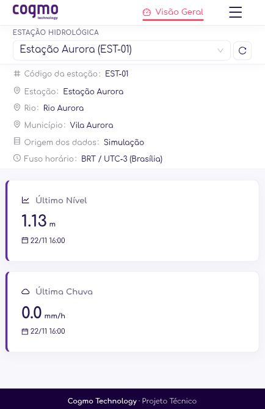
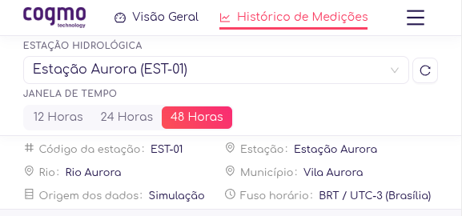
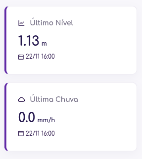
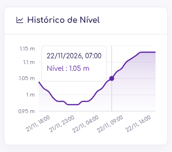
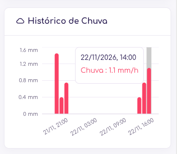
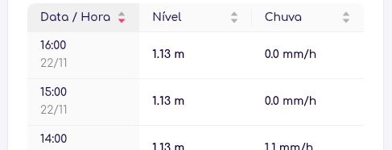
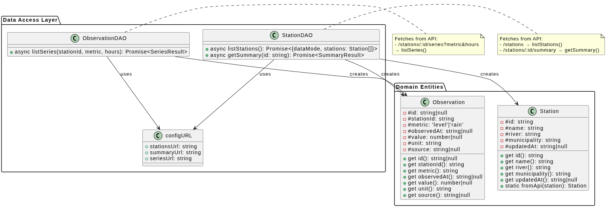
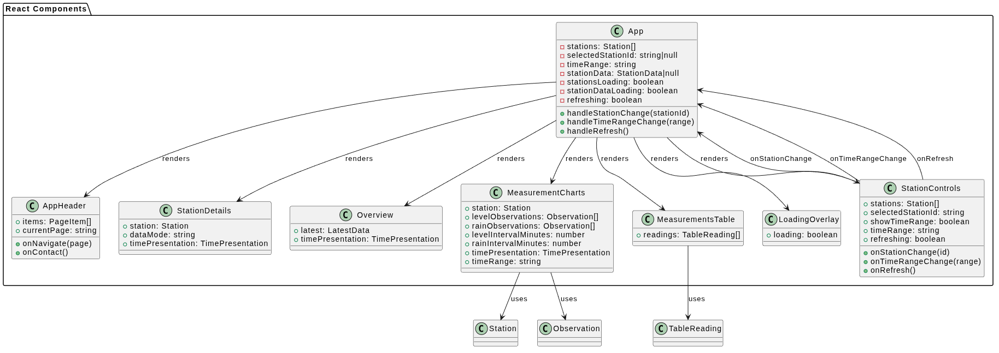
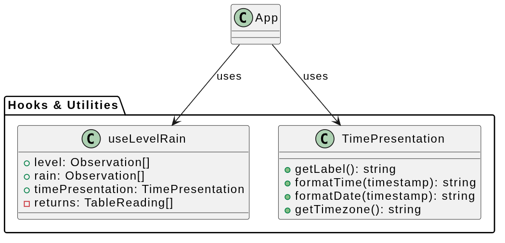

# Monitoramento Hidrológico

Interface web de monitoramento de dados hidrológicos de nível de rio e precipitação pluvial.  

Visualize medições recentes e faça análises de séries históricas por meio de tabelas e gráficos interativos!  


||  
|---|  

<br />Acesse o aplicativo: https://hydrocogmo.vercel.app/  

## Links  

#### API REST com dados simulados:  

https://monitoramento-hidrologico-api.onrender.com

| Nome | Método | Endpoint  
| :---: | :---: | :--- | 
| Health | GET | api/health |
| Stations | GET | api/stations |
| Summary | GET | api/stations/{stationid}/summary |
| Series | GET | api/stations/{stationid}/series?metric={metric}&hours={timeframe} |

#### Repositório front end:  
https://github.com/silver-ward/monitoramento-hidrologico  

#### Repositório back end:  
https://github.com/silver-ward/monitoramento-hidrologico-API

## Funcionalidades
**Listagem e seleção de estações**  
Selecione diferentes estações de monitoramento hidrológico e defina a janela de tempo dos dados recuperados.  
||  
|---|  

**Cartões de resumo**  
Fique à par das medições de chuva e nível do rio mais recentes.  
||  
|---|

**Gráficos dinâmicos**  
Analise séries históricas de chuva e nível do rio por meio de gráficos interativos.  
|||  
|---|---| 

**Tabela de dados**  
Visualize cada leitura de nível e chuva disponibilizados pela estação e organize os dados em ordem crescente ou decrescente a partir de qualquer uma das colunas.  
||  
|---|  

## Desenvolvimento

### Tecnologias e bibliotecas utilizadas:  
* **JavaScript** / **HTML** / **CSS**  
    Linguagens de programação, estruturação e apresentação web.  
* **Vite**  
    Ferramenta de build e ambiente de desenvolvimento.  
* **Node.js**  
    Ambiente de execução para JavaScript.  
* **ReactJS**  
    Biblioteca para construção de componentes e gestão de estados.  
* **Ant Design**  
    Biblioteca de componentes de interface de usuário.  
* **Recharts**  
    Biblioteca de renderização de gráficos.  
* **Storybook**  
    Ferramenta de testes para componentes de interface React/Vue.  

### Requisitos Funcionais:  
| Código | Funcionalidade | Status |  
| :---: | :--- | :---: |  
| **RF01** | Listar as estações de monitoramento disponíveis | ☑ |  
| **RF02** | Permitir selecionar uma estação | ☑ |  
| **RF03** | Exibir rio e município da estação selecionada | ☑ |  
| **RF04** | Exibir a última medição de nível do rio (com unidade e horário) | ☑ |  
| **RF05** | Exibir a última medição de precipitação (com unidade e horário) | ☑ |  
| **RF06** | Apresentar gráfico histórico do nível do rio | ☑ |  
| **RF07** | Apresentar gráfico histórico de precipitação separado do nível | ☑ |  
| **RF08** | Permitir selecionar períodos de 12, 24 ou 48 horas | ☑ |  
| **RF09** | Informar quando não existirem dados disponíveis | ☑ |  
| **RF10** | Apresentar medições em tabela | ☑ |  
| **RF11** | Permitir ordenar e filtrar registros da tabela | ☑ |  

## Modelagem dos Dados

### Diagrama de Classes

Para visualizar o diagrama completo, renderize o conteúdo de /diagrams/full_diagram.puml no endereço https://www.plantuml.com/plantuml.  

**Diagrama de dados**  
  


**Diagrama de componentes**  
  


**Diagrama de hooks e utilidades**  
  

## Execução Local

Para executar este projeto localmente, siga os seguintes passos em um terminal de comandos:  
   
* Integração com este repositório no GitHub  
    Pré-requisitos: [Git](https://git-scm.com/).  


    1. **Clone o repositório:**
        ```
        git clone https://github.com/silver-ward/monitoramento-hidrologico.git
        ```

    2. **Entre no diretório que foi clonado:**
        ```
        cd monitoramento-hidrologico
        ```

* Execução do código  
    Pré-requisitos: [Node.js](https://nodejs.org/).  

    3. **Instale as dependências:**
        ```
        npm install
        ```

    4. **Inicie o servidor de desenvolvimento:**
        ```
        npm run dev
        ```

    5. **Abra no navegador o endereço localhost especificado no terminal.**  
        Exemplo:  
        ```
        http://localhost:5173/
        ```

    Para acessar dados de uma API, defina URLs sem proteção CORS no arquivo /src/data/DAOs/configURL.js.  

* Testes de interface de usuário  
    
    6. **Inicie o servidor de testes Storybook:**  
        ```
        npm run storybook
        ```

    7. **Abra no navegador o endereço localhost especificado no terminal.**  
        Exemplo:  
        ```
        http://127.0.0.1:6006/
        ```

## Licença

Projeto desenvolvido por Eduardo Ribeiro, Leonilson Araújo e Rebeca Nogueira para a Cogmo Technology no âmbito do programa Bolsa Futuro Digital, realizado por parceria entre o Instituto Hardware Brasil e o Instituto Federal de Brasília.


